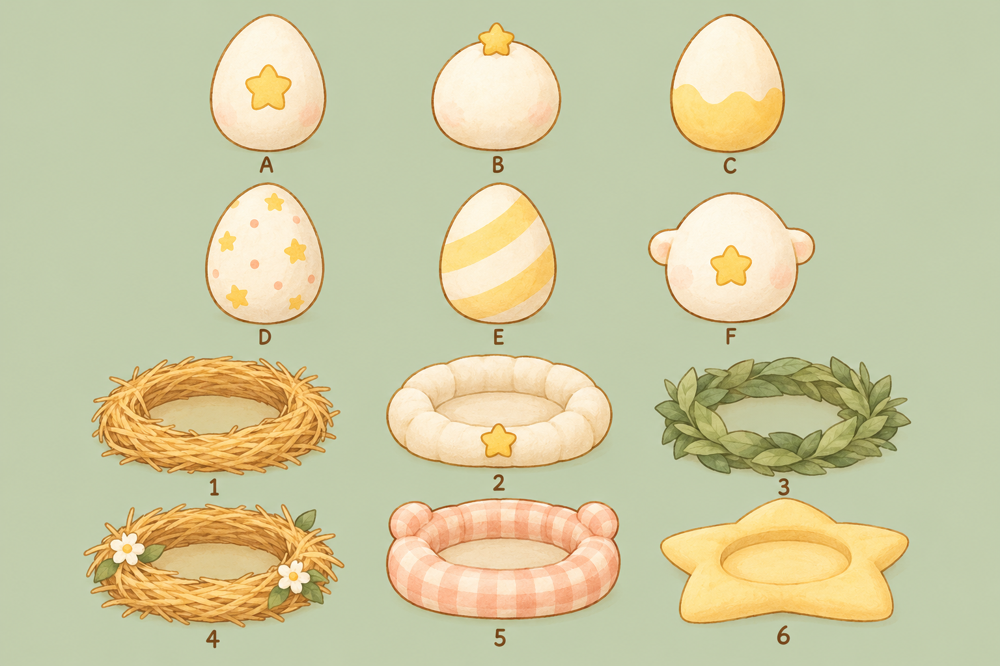

# Little Rascal — Egg and nest concepts

These are concept options for selection, not final game assets. The game code and current visuals are unchanged. Generated with OpenAI image generation as design exploration.

Choose an egg letter and a nest number independently.

| Egg | Design | Nest | Design |
| --- | --- | --- | --- |
| A | Cream egg with a front yellow star | 1 | Golden straw ring |
| B | Round cream egg with a star on top | 2 | Cream padded nest with front star |
| C | Cream egg with a yellow wavy lower half | 3 | Sage green leaf nest |
| D | Small yellow stars and peach dots | 4 | Straw nest with white flowers |
| E | Pale yellow diagonal bands | 5 | Peach gingham padded nest |
| F | Rounded side bumps and front star | 6 | Yellow star-shaped cushion |

Suggested combinations: B + 2 echoes the pet's signature star; A + 4 complements the watercolor room.

After selection, export the egg and nest separately as transparent assets. Do not integrate them into gameplay until requested.
